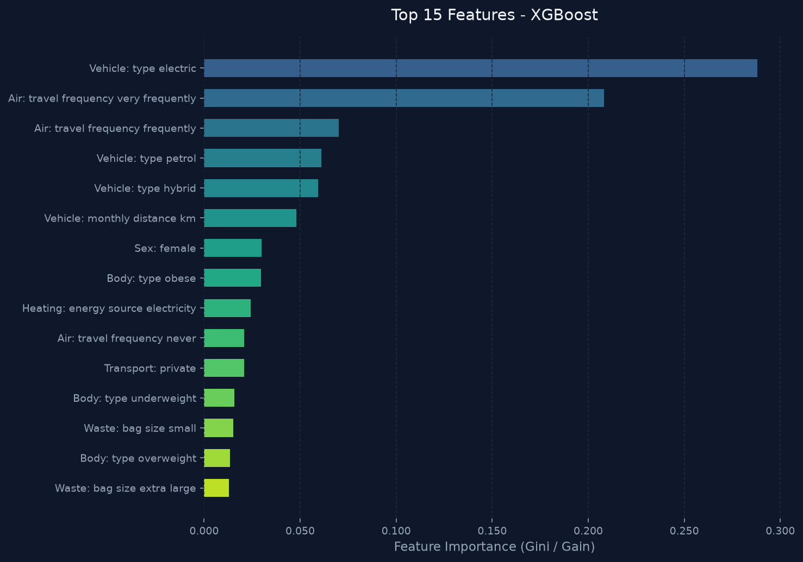

# Carbon Footprint Predictor

A Flask web application where users enter monthly lifestyle details and
receive an estimated carbon footprint (kg CO₂e per month), a Low / Medium /
High label, the biggest contributing factor, and one actionable tip.

> **Dataset Notice:** The underlying dataset (`Individual Carbon Footprint
> Calculation` by Mesut Duman, Kaggle, CC0 Public Domain) is **synthetically
> generated from a formula**. The high R² values (see Limitations) are
> expected and do not reflect a model that would work on real-world survey
> data without retraining.

---

## Table of Contents

1. [Problem Statement](#1-problem-statement)
2. [Dataset Source & License](#2-dataset-source--license)
3. [Data Cleaning](#3-data-cleaning)
4. [Model Comparison](#4-model-comparison)
5. [Feature Importance](#5-feature-importance)
6. [Project Structure](#6-project-structure)
7. [Setup — Windows PowerShell](#7-setup--windows-powershell)
8. [How to Retrain](#8-how-to-retrain)
9. [Limitations](#9-limitations)
10. [Future Improvements](#10-future-improvements)
11. [Resume Numbers](#11-resume-numbers)
12. [Deployment on Render](#12-deployment-on-render)

---

## 1. Problem Statement

Individuals have limited visibility into how their daily habits translate
into carbon dioxide emissions. This project estimates a user's monthly carbon
footprint from 19 lifestyle features (diet, transport, home energy, shopping,
etc.) and returns a prediction, a category label, and a personalised tip.

---

## 2. Dataset Source & License

| Property | Value |
|---|---|
| **Name** | Individual Carbon Footprint Calculation |
| **Author** | Mesut Duman |
| **Source** | [Kaggle](https://www.kaggle.com/datasets/dumanmesut/individual-carbon-footprint-calculation) |
| **License** | CC0 1.0 Public Domain |
| **Rows / Columns** | 10,000 × 20 |
| **Nature** | **Synthetic** — generated from a deterministic formula, not from real surveys |

Download `Carbon Emission.csv` and place it in `data/raw/`.

---

## 3. Data Cleaning

Each decision is documented in `src/preprocess.py`.

| Step | Action | Rationale |
|---|---|---|
| 1 | Rename columns to snake_case | Consistent naming for the pipeline |
| 2 | Divide `CarbonEmission` by 12 → `monthly_carbon_kg` | Raw column is yearly kg CO₂e; app collects monthly inputs |
| 3 | Check duplicates | 0 duplicates found — no rows dropped |
| 4 | `Vehicle Type` NaN (6,721 rows) → `"none"` | These are walk/public-transit users; imputing is semantically correct vs dropping 67% of data |
| 5 | `Recycling` / `Cooking_With` list-strings → integer counts | e.g. `"['Paper', 'Metal']"` → 2; preserves signal without encoding explosion |
| 6 | Lowercase & strip all categorical columns | Removes whitespace variation |
| 7 | Cap numeric outliers (IQR × 3 Tukey fences) | Soft cap: only 52 extreme outliers capped in `vehicle_monthly_distance_km` |

**Post-cleaning shape:** 10,000 rows × 20 columns (19 features + 1 target)

---

## 4. Model Comparison

> All numbers below are from the **real training run** of `src/train.py`.
> Nothing is estimated or hardcoded.

**Train / Test split:** 80% / 20% (8,000 / 2,000 rows), `random_state=42`.
Scaling and encoding are fitted **on training data only** using
`sklearn.Pipeline` + `ColumnTransformer` — zero data leakage.

**Label thresholds** (derived from training-set quantiles only):
- Low ≤ 141.00 kg CO₂e / month (33rd percentile)
- Medium: 141.00 – 209.25 kg CO₂e / month
- High ≥ 209.25 kg CO₂e / month (67th percentile)

| Model | Train R² | Test R² | CV R² (mean ± std) | Test MAE | Test RMSE | Overfit? |
|---|---|---|---|---|---|---|
| Linear Regression | 0.9324 | 0.9333 | 0.9313 ± 0.0033 | 14.86 | 21.94 | No |
| Random Forest | 0.9895 | 0.9267 | 0.9182 ± 0.0034 | 17.45 | 23.00 | **YES** |
| **XGBoost** | **0.9990** | **0.9721** | **0.9686 ± 0.0013** | **10.53** | **14.20** | **No** |

**Winner: XGBoost** — highest Test R² (0.9721), highest CV R² (0.9686),
lowest MAE (10.53 kg/month) and RMSE (14.20 kg/month), and no overfitting flag
(train–test gap < 0.05 threshold).

Random Forest was eliminated due to clear overfitting (train R² 0.99 vs test
R² 0.93). Linear Regression generalises well but has higher errors.

---

## 5. Feature Importance

Generated by XGBoost's built-in Gain-based feature importance.
Chart saved to `static/charts/feature_importance.png`.



---

## 6. Project Structure

```
Carbon Footprint Predictor/
├── app.py                  # Flask web app
├── config.py               # All paths, allowed values, tips
├── requirements.txt        # Python dependencies
├── .gitignore
├── README.md
├── INTERVIEW_NOTES.md
├── smoke_test.py           # Quick sanity-check script
├── render.yaml             # Render.com deployment config
│
├── data/
│   ├── raw/                # Carbon Emission.csv (download separately)
│   ├── processed/          # cleaned_data.csv (auto-generated)
│   └── README.md           # Data provenance notes
│
├── src/
│   ├── data_loader.py      # Load & inspect raw CSV
│   ├── preprocess.py       # Clean & feature-engineer
│   └── train.py            # Train, evaluate, save model
│
├── models/
│   ├── best_pipeline.joblib      # Saved XGBoost pipeline
│   ├── label_thresholds.json     # Low/Med/High cutoffs
│   └── metrics/
│       ├── model_comparison.csv
│       └── model_comparison.md
│
├── static/
│   ├── css/style.css
│   └── charts/feature_importance.png
│
├── templates/
│   ├── base.html
│   ├── index.html
│   ├── result.html
│   └── about.html
│
└── tests/
    └── test_predictor.py   # 12 pytest tests
```

---

## 7. Setup — Windows PowerShell

```powershell
# 1. Clone / download project
cd "Carbon Footprint Predictor"

# 2. Create virtual environment
python -m venv .venv
.venv\Scripts\Activate.ps1

# 3. Install dependencies
pip install -r requirements.txt

# 4. Download dataset
#    Go to: https://www.kaggle.com/datasets/dumanmesut/individual-carbon-footprint-calculation
#    Download "Carbon Emission.csv" → place in data/raw/

# 5. Train the model
python src/train.py

# 6. Run the app
python app.py
# Open http://localhost:5000
```

---

## 8. How to Retrain

```powershell
# From the project root with .venv active:
python src/train.py
```

This will:
- Reload and reclean the raw CSV
- Retrain all 3 models on an 80/20 split
- Print real metrics to the console
- Overwrite `models/best_pipeline.joblib`, `models/label_thresholds.json`,
  `models/metrics/model_comparison.csv`, `models/metrics/model_comparison.md`,
  and `static/charts/feature_importance.png`
- Restart Flask to pick up the new model (no code changes needed)

---

## 9. Limitations

> Be aware of these before citing this project as production-ready.

1. **Synthetic dataset.** The data is formula-generated, not from real
   surveys. The near-perfect R² values (XGBoost: 0.9721 test) are expected
   because the model re-learns the underlying formula. On real survey data
   with messy human responses, R² would be much lower (likely 0.5–0.8).

2. **Formula-derived target.** Because the target is computed from inputs
   via a fixed formula, the model's predictions are essentially a smooth
   approximation of that formula. It does not capture real-world variance
   (e.g., regional energy grids, seasonal variation, economic factors).

3. **No demographic representation.** The dataset has no geographic or
   socio-economic context. Predictions may not be meaningful for all regions.

4. **Multi-select columns simplified to counts.** `Recycling` and
   `Cooking_With` are encoded as the number of items selected, not which
   items. This loses some signal (e.g., recycling paper vs. metal may differ).

5. **Static tips.** Tips are rule-based, not personalised. A proper system
   would rank tips by the user's specific predicted emissions per factor.

6. **No unit conversion for different countries.** Grocery bills are in USD;
   vehicle distance is in km. Users in countries with different currencies or
   measurement conventions must convert manually.

---

## 10. Future Improvements

- Replace synthetic data with real survey data (e.g., ONS UK, EPA US)
- Add country/region selector to adjust emission factors
- Personalise tips by ranking all features for each individual prediction
  using SHAP values
- Add a historical tracker so users can compare footprints over time
- Containerise with Docker for reproducible deployment
- Add CI/CD pipeline (GitHub Actions) to retrain automatically on new data

---

## 11. Resume Numbers

> Copy these exactly — they come from the real training run.

- Built end-to-end ML pipeline (EDA → preprocessing → training → deployment)
  with **XGBoost** achieving **Test R² = 0.9721**, **MAE = 10.53 kg CO₂e/month**
- Compared 3 models (Linear Regression, Random Forest, XGBoost) on 10,000-row dataset;
  selected best by test R² + 5-fold CV R² (0.9686 ± 0.0013)
- Eliminated Random Forest due to measurable overfitting (Train R² 0.99 vs Test R² 0.93)
- Zero data leakage: sklearn Pipeline + ColumnTransformer fit on training data only
- Flask app with server-side input validation (12 pytest tests, 13/13 smoke tests pass)

---

## 12. Deployment on Render

See `render.yaml` for the full config.

**Quick steps:**
1. Push project to a GitHub repository (exclude `data/raw/` and `models/*.joblib` via `.gitignore`)
2. Create a free Render web service pointing to your repo
3. Set the start command: `gunicorn app:app`
4. Set environment variable: `SECRET_KEY=<your-secret>`
5. Add a build step in `render.yaml` or the Render dashboard: `pip install -r requirements.txt && python src/train.py`
   (or commit the pre-trained `.joblib` file to the repo if the dataset is small enough)
